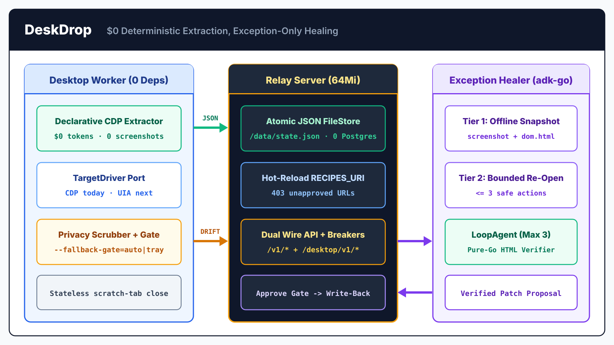

# DeskDrop



Pull structured JSON from authenticated web pages using your running browser — with a single zero-dependency Go binary, zero databases, and an AI repair loop that runs only when a page layout changes.

## Why DeskDrop

- **Happy path costs `$0` in LLM tokens:** Attaches over Chrome DevTools Protocol (CDP) to your logged-in browser, runs declarative CSS / `>>>` Shadow-DOM `items`, `fields`, and bounded `"Next page"` `pagination` rules (`0` `eval_js`), emits clean JSON, and captures zero screenshots, HTML dumps, or `AXTree` snapshots.
- **Zero-dependency desktop binary:** `cmd/deskdrop` links strictly Go standard library packages (`CGO_ENABLED=0`, verified in [`hygiene_test.go`](hygiene_test.go)), with a native Windows System Tray, a `schtasks.exe` helper (`deskdrop schedule`), and a single-attempt Chrome 144+ `DevToolsActivePort` approval latch.
- **Zero Postgres relay:** `cmd/server` persists state atomically to `/data/state.json` inside a `64Mi` distroless image and hot-reloads approved recipes from `RECIPES_URI` (local path or `gs://`), rejecting unapproved ad-hoc URLs with `HTTP 403`.
- **Exception-only healing with hybrid `AXTree` grounding & human approval:** On `SELECTOR_DRIFT`, `deskdrop` packages scrubbed `dom.html`, privacy-redacted compact `axtree.txt` (`Accessibility.getFullAXTree`), and `screenshot.png` (detecting unlabelled `<canvas>`/WebGL blind spots automatically), closes the scratch tab immediately, runs `google.golang.org/adk/v2` (`SequentialAgent` + `LoopAgent` with pure-Go `verify_recipe_on_snapshot`), and writes patched recipes back to `RECIPES_URI` only after explicit `POST /v1/proposals/{id}/approve`.

## Ports, Adapters, and Contracts

| Layer | Package / File | Responsibility |
| :--- | :--- | :--- |
| **Contracts** | [`internal/contract/`](internal/contract/), [`specs/`](specs/) | Declarative `Recipe`/`FieldRule`/`ItemRule`, `FallbackPlan`, `RecipePatchProposal`, HTML scrubber, air-gap guard, OpenAPI + behavioral specs |
| **Driving Port** | [`internal/server/http.go`](internal/server/http.go) | Wire-compatible `/v1/*` and `/desktop/v1/*` control plane with scoped tokens and approval gates |
| **Driven Port (`TargetDriver`)** | [`internal/driver/`](internal/driver/) → [`internal/driver/cdp/`](internal/driver/cdp/) | Browser CDP Adapter today; ready for native desktop accessibility (`UIA`) Adapter next |
| **Driven Port (`Store`)** | [`internal/server/store_file.go`](internal/server/store_file.go) | Mutex-guarded `MemoryStore` persisted via temp-file + `fsync` + atomic rename (`/data/state.json`) |
| **Driven Port (`Catalog`)** | [`internal/recipes/catalog.go`](internal/recipes/catalog.go) | Hot-reloadable `RECIPES_URI` (local file/dir or `gs://` ETag) + `HTTP 403` domain allowlist |
| **Driven Port (`ExceptionHealer`)** | [`internal/healer/healer.go`](internal/healer/healer.go) + [`internal/verify/`](internal/verify/) | `adk-go` Tier-1 offline fallback, bounded Tier-2 (`<= 3` safe actions), and pure-Go HTML verifier loop |

## Quick Start

### 1. Run Verification & Drift Self-Healing Benchmark

```bash
./scripts/gate.sh
```

This runs `gofmt -s`, `go vet ./...`, all `-race` unit tests, the zero-external-dependency CLI check, and the offline `testdata/drift/` v1-to-v2 `adk-go` regeneration benchmark (`internal/healer/healer_test.go`).

### 2. Run the Relay Locally

```bash
export STORE_BACKEND=file
export STATE_FILE=/tmp/deskdrop-state.json
export STORAGE_BACKEND=local
export LOCAL_BLOB_DIR=/tmp/deskdrop-blobs
export RECIPES_URI=./examples/recipes
export DESKTOP_CLIENT_TOKEN=dev-desktop-token
export AGENT_BUS_TOKEN=dev-agent-token
go run ./cmd/server
```

### 3. Run the Desktop Worker

Copy [`deskdrop.example.json`](deskdrop.example.json) to `deskdrop.json`, then:

```bash
# Dry-run a declarative recipe locally
go run ./cmd/deskdrop run examples/recipes/status-dashboard.json --dry-run

# Drain queued tasks continuously with Tier-2 fallback confirmation gated in tray
go run ./cmd/deskdrop sync --interval 20s --fallback-gate=tray

# Preview or install a quiet 15-minute Windows Scheduled Task (schtasks.exe)
go run ./cmd/deskdrop schedule install --every 15m --fallback-gate tray --dry-run
```

## Declarative Recipe Format (Zero `eval_js`)

See [`examples/recipes/status-dashboard.json`](examples/recipes/status-dashboard.json) and [`examples/recipes/release-feed.json`](examples/recipes/release-feed.json). Every rule supports CSS + `>>>` Shadow-DOM selectors, attribute fallbacks (`aria-label|text`), ancestor climbing (`closest` / `anchor_closest`), regex capture + fallback regex, compact numbers (`1.2K`, `3.5M`), `click_if_present`, and bounded multi-page `pagination` (`next_selector`, `max_pages`, disabled/`aria-disabled` stop, cross-page deduplication).

## Regenerative Blueprint & Docs

- [`prompts/REGENERATE.md`](prompts/REGENERATE.md) — Delete-and-regenerate workflow for bounded adapters
- [`DECISIONS.md`](DECISIONS.md) — Architectural decision records (`ADR-001`–`ADR-006`)
- [`CRITICAL.md`](CRITICAL.md) — Hard security, privacy, and compile-boundary invariants
- [`docs/roadmap.md`](docs/roadmap.md) — Release plan and post-v1.0 backlog
